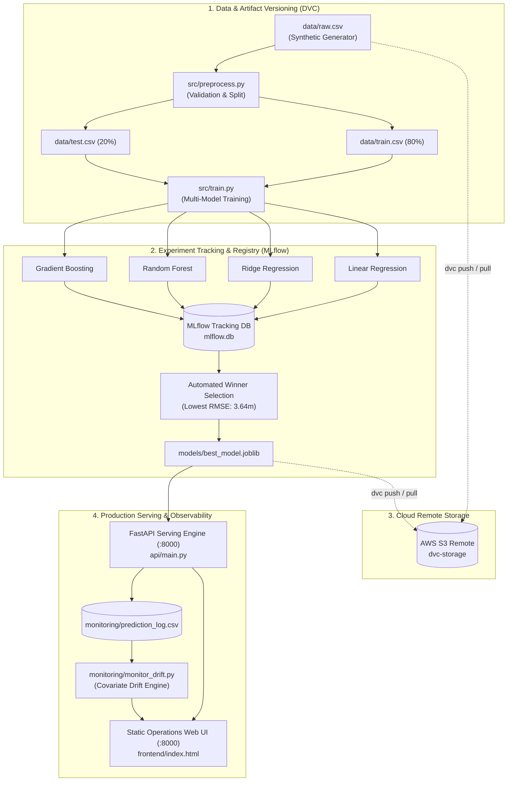
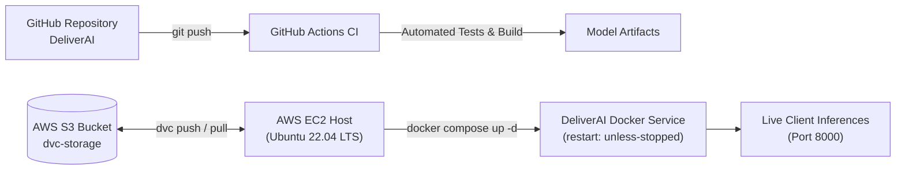

# ⚡ DeliverAI — Production-Grade Food Delivery ETA Prediction Engine

[](https://github.com/riddhimk/DeliverAI/actions/workflows/ci.yml)
[](https://fastapi.tiangolo.com)
[](https://scikit-learn.org)
[](https://mlflow.org)
[](https://dvc.org)
[](https://www.docker.com)
[](https://www.python.org)
[](https://opensource.org/licenses/MIT)

**DeliverAI** is an enterprise-grade Machine Learning Operations (MLOps) platform engineered to predict high-accuracy Food Delivery Estimated Time of Arrival (ETA in minutes). By synthesizing dynamic multi-factor dispatch parameters — trip distance, real-time weather anomalies, traffic congestion levels, vehicle physics, kitchen preparation latency, and courier experience — DeliverAI provides sub-10ms inference and operational transparency.

The platform embodies modern MLOps architecture: automated data versioning, reproducible transformation pipelines, multi-model experiment tracking, continuous covariate drift monitoring, containerized microservices with self-healing recovery policies, and automated cloud provisioning.

---

## 🏛️ System Architecture



---

## ✨ Key Capabilities

- **Zero Train/Serve Skew:** Built on a unified scikit-learn `ColumnTransformer` pipeline that bundles one-hot encoding, feature normalization, and regression logic directly into the serialized artifact (`models/best_model.joblib`).
- **Automated Experiment Benchmarking:** Automatically fits and tracks 4 candidate regressors against test splits, logging hyperparameters, MAE, RMSE, $R^2$, and MAPE to an MLflow SQLite backend.
- **Continuous Data Drift Detection:** Real-time request logging to detect distribution shifts and covariate drift between live inference payloads and baseline training datasets.
- **Sub-10ms Inference API:** High-throughput FastAPI backend with strict Pydantic payload validation and automatic OpenAPI / Swagger specifications.
- **Unified Modern Operations UI:** High-performance, zero-build static web interface (HTML5 / Vanilla JS / Glassmorphic CSS) served directly on port `8000` with interactive parameter sliders, MLflow model showdown, and live drift radar.
- **Resilient Containerization:** Dockerized deployment with health checks (`HEALTHCHECK`) and automated container restart policies (`restart: unless-stopped`) ensuring high availability.
- **Cloud Infrastructure Automation:** Ready-to-execute provisioning scripts for AWS EC2 instance hosting and AWS S3 remote DVC data synchronization.

---

## 📊 Model Performance & Benchmarking

DeliverAI trains and benchmarks multiple candidate architectures on hold-out validation sets. Model evaluation metrics are automatically logged to MLflow:

| Model Architecture | MAE (min) | RMSE (min) | $R^2$ Score | MAPE (%) | Status |
|---|:---:|:---:|:---:|:---:|:---:|
| **Gradient Boosting Regressor** | **2.88** | **3.64** | **0.921** | **10.9%** | **🏆 Champion (Deployed)** |
| Ridge Regression ($\alpha=1.0$) | 3.02 | 3.85 | 0.911 | 11.4% | Candidate |
| Ordinary Least Squares (Linear) | 3.02 | 3.85 | 0.911 | 11.4% | Candidate |
| Random Forest ($n=200, d=10$) | 3.26 | 4.17 | 0.896 | 12.2% | Candidate |

The winning **Gradient Boosting Regressor** is automatically exported to `models/best_model.joblib` and hot-loaded by the serving engine.

---

## 🚀 Quickstart Guide

### 1. Environment Setup

Clone the repository and initialize the Python virtual environment:

```bash
# Clone the repository
git clone https://github.com/riddhimk/DeliverAI.git
cd DeliverAI

# Create virtual environment
python -m venv venv

# Activate virtual environment
# Windows PowerShell:
.\venv\Scripts\Activate.ps1
# Linux / macOS:
# source venv/bin/activate

# Install locked dependencies
pip install -r requirements.txt
```

### 2. Launch the Application

Start the unified FastAPI prediction engine and static web operations dashboard:

```bash
uvicorn api.main:app --reload --port 8000
```

Access the services in your browser:
- **Operations Dashboard:** [http://localhost:8000](http://localhost:8000)
- **Interactive Swagger Documentation:** [http://localhost:8000/docs](http://localhost:8000/docs)
- **Service Health Check:** [http://localhost:8000/health](http://localhost:8000/health)

---

## 🧪 Automated Testing Suite

DeliverAI maintains strict quality gates via `pytest`. The test suite covers pipeline integrity, preprocessing boundaries, regression fitting, drift computation, and API endpoints:

```bash
pytest tests/ -v
```

```text
tests/test_pipeline.py::test_generate_data_shape PASSED                  [ 16%]
tests/test_pipeline.py::test_preprocess_stage PASSED                     [ 33%]
tests/test_pipeline.py::test_pipeline_fits_and_predicts PASSED           [ 50%]
tests/test_pipeline.py::test_drift_computation PASSED                    [ 66%]
tests/test_pipeline.py::test_api_health_and_predict PASSED               [ 83%]
tests/test_pipeline.py::test_api_static_frontend_and_monitoring PASSED   [100%]
============================== 6 passed in 5.6s ===============================
```

---

## 🔄 Reproducible MLOps Pipeline (DVC)

DeliverAI utilizes **Data Version Control (DVC)** to define a declarative, directed acyclic graph (DAG) across data generation, preprocessing, and training stages:

```bash
# Reproduce pipeline (skips cached stages if inputs are unchanged)
dvc repro

# Force reproduction of all stages
dvc repro -f

# Synchronize artifacts to cloud remote storage
dvc push

# Pull versioned artifacts onto a new machine
dvc pull
```

### Modular Pipeline Stages (`dvc.yaml`):
1. **`generate_data`:** Produces a realistic synthetic dataset (`data/raw.csv`) modeling speed curves, courier experience, prep delays, and weather coefficients.
2. **`preprocess`:** Validates data contracts, schema constraints, and executes an 80/20 train/test partition (`data/train.csv`, `data/test.csv`).
3. **`train`:** Fits 4 candidate algorithms, logs experiments to MLflow, evaluates validation metrics, and serializes the champion model to `models/best_model.joblib`.

---

## 📈 Experiment Tracking & Observability (MLflow)

All training metrics, parameters, and serialized scikit-learn model trees are tracked in a persistent SQLite backend.

To launch the MLflow UI:
```bash
mlflow ui --backend-store-uri sqlite:///mlflow.db --port 5000
```
Open [http://localhost:5000](http://localhost:5000) to inspect:
- Comparative hyperparameter tuning runs.
- Loss curves and residual distributions.
- Parameter-to-metric correlations across runs.

---

## 🛡️ Post-Deployment Drift Detection

Production machine learning models degrade over time as real-world distributions shift. DeliverAI logs every live inference request asynchronously to `monitoring/prediction_log.csv`.

To execute a statistical distribution audit:
```bash
python monitoring/monitor_drift.py
```
The drift engine computes feature-level distribution shifts in standard deviation units against training reference distributions, generating `monitoring/drift_report.json`. Live metrics are streamed directly to the web dashboard and queryable via `GET /api/drift`.

---

## 🐳 Containerized Deployment (Docker)

DeliverAI provides a production-ready multi-service container setup with native health probes and self-healing policies:

```bash
# Build and run container in detached mode
docker compose up --build -d

# Verify container health and status
docker compose ps

# View live application logs
docker compose logs -f deliverai

# Stop the container
docker compose down
```

The container enforces `restart: unless-stopped`, ensuring automated recovery upon host reboots or unexpected process termination.

---

## ☁️ Cloud Deployment Architecture (AWS EC2 & S3)



### Automated EC2 Deployment in One Command:
1. Launch an Ubuntu 22.04 LTS EC2 instance (`t3.medium` or `t2.medium`) with Inbound Port **8000** open.
2. Connect via SSH and run the automated provisioning script:
   ```bash
   curl -fsSL https://raw.githubusercontent.com/riddhimk/DeliverAI/main/deploy/ec2_setup.sh | bash
   ```
3. The script provisions Docker, clones the repository, builds the container image, and starts the service in detached mode.

### Synchronizing Cloud Remote Storage (AWS S3):
```bash
# Configure S3 bucket remote
bash deploy/s3_dvc_setup.sh <bucket-name> <aws-region>

# Push tracked models and datasets to S3
dvc push -r s3remote
```

---

## 🔌 REST API Specification

| Method | Endpoint | Description | Sample Output |
|---|---|---|---|
| `GET` | `/health` | Service and model availability status | `{"status": "ok", "model_loaded": true}` |
| `POST` | `/predict` | Computes estimated delivery time in minutes | `{"predicted_eta_min": 24.6, "model_used": "gradient_boosting", "rmse": 3.64}` |
| `GET` | `/api/models` | Performance benchmark across all tracked candidate models | `[{"name": "Gradient Boosting", "rmse": 3.64, "best": true}, ...]` |
| `GET` | `/api/drift` | Live feature distribution drift metrics and alerts | `{"features_monitored": 3, "drift_alerts": 0, "drift": [...]}` |
| `GET` | `/docs` | Interactive OpenAPI / Swagger interface | Full interactive documentation |

### Example Request (`POST /predict`):
```bash
curl -X POST http://localhost:8000/predict \
  -H "Content-Type: application/json" \
  -d '{
    "distance_km": 5.4,
    "vehicle_type": "bike",
    "weather": "clear",
    "traffic_level": "medium",
    "prep_time_min": 14.0,
    "courier_experience_yr": 3.0
  }'
```

Response:
```json
{
  "predicted_eta_min": 24.6,
  "model_used": "gradient_boosting",
  "rmse": 3.64
}
```

---

## 📁 Repository Structure

```text
DeliverAI/
├── .dvc/                  # DVC remote and cache configurations
├── .github/workflows/     # GitHub Actions CI pipeline specifications
├── api/
│   └── main.py            # FastAPI service, endpoints, static frontend mount
├── data/
│   ├── generate_data.py   # Synthetic data generation engine
│   ├── raw.csv            # DVC-tracked raw delivery dataset
│   ├── train.csv          # Partitioned training dataset
│   └── test.csv           # Partitioned evaluation dataset
├── deploy/
│   ├── ec2_setup.sh       # Automated AWS EC2 provisioning script
│   └── s3_dvc_setup.sh    # Automated AWS S3 remote configuration script
├── frontend/
│   ├── index.html         # Modern static operations web UI
│   ├── style.css          # Glassmorphic dark-mode stylesheets
│   └── app.js             # Vanilla JS client communicating with API
├── models/
│   ├── best_model.joblib  # Serialized winning pipeline (ColumnTransformer + Regressor)
│   ├── best_model_info.json # Metadata and validation metrics of champion model
│   └── model_comparison.csv # Comparative benchmark table across all models
├── monitoring/
│   ├── monitor_drift.py   # Statistical covariate drift computation engine
│   ├── prediction_log.csv # Runtime inference audit log
│   └── drift_report.json  # Drift analysis report
├── src/
│   ├── preprocessing.py   # Shared scikit-learn ColumnTransformer pipeline
│   ├── preprocess.py      # Standalone DVC data preprocessing & split stage
│   └── train.py           # Multi-model training and MLflow tracking stage
├── tests/
│   └── test_pipeline.py   # Comprehensive automated test suite (pytest)
├── docker-compose.yml     # Multi-service container orchestration
├── Dockerfile             # Production container definition with health check
├── dvc.yaml               # Reproducible DVC pipeline definition
├── dvc.lock               # DVC content hash lock
├── requirements.txt       # Pinned production dependencies
└── README.md              # Project documentation
```

---

## 📄 License
This project is open-source and distributed under the [MIT License](LICENSE).

```text
DeliverAI/
├── .dvc/                  # DVC remote and cache configurations
├── .github/workflows/     # GitHub Actions CI pipeline specifications
├── api/
│   └── main.py            # FastAPI service, endpoints, static frontend mount
├── data/
│   ├── generate_data.py   # Synthetic data generation engine
│   ├── raw.csv            # DVC-tracked raw delivery dataset
│   ├── train.csv          # Partitioned training dataset
│   └── test.csv           # Partitioned evaluation dataset
├── deploy/
│   ├── ec2_setup.sh       # Automated AWS EC2 provisioning script
│   └── s3_dvc_setup.sh    # Automated AWS S3 remote configuration script
├── frontend/
│   ├── index.html         # Modern static operations web UI
│   ├── style.css          # Glassmorphic dark-mode stylesheets
│   └── app.js             # Vanilla JS client communicating with API
├── models/
│   ├── best_model.joblib  # Serialized winning pipeline (ColumnTransformer + Regressor)
│   ├── best_model_info.json # Metadata and validation metrics of champion model
│   └── model_comparison.csv # Comparative benchmark table across all models
├── monitoring/
│   ├── monitor_drift.py   # Statistical covariate drift computation engine
│   ├── prediction_log.csv # Runtime inference audit log
│   └── drift_report.json  # Drift analysis report
├── src/
│   ├── preprocessing.py   # Shared scikit-learn ColumnTransformer pipeline
│   ├── preprocess.py      # Standalone DVC data preprocessing & split stage
│   └── train.py           # Multi-model training and MLflow tracking stage
├── tests/
│   └── test_pipeline.py   # Comprehensive automated test suite (pytest)
├── docker-compose.yml     # Multi-service container orchestration
├── Dockerfile             # Production container definition with health check
├── dvc.yaml               # Reproducible DVC pipeline definition
├── dvc.lock               # DVC content hash lock
├── requirements.txt       # Pinned production dependencies
└── README.md              # Project documentation
```

---

## 📄 License
This project is open-source and distributed under the [MIT License](LICENSE).

